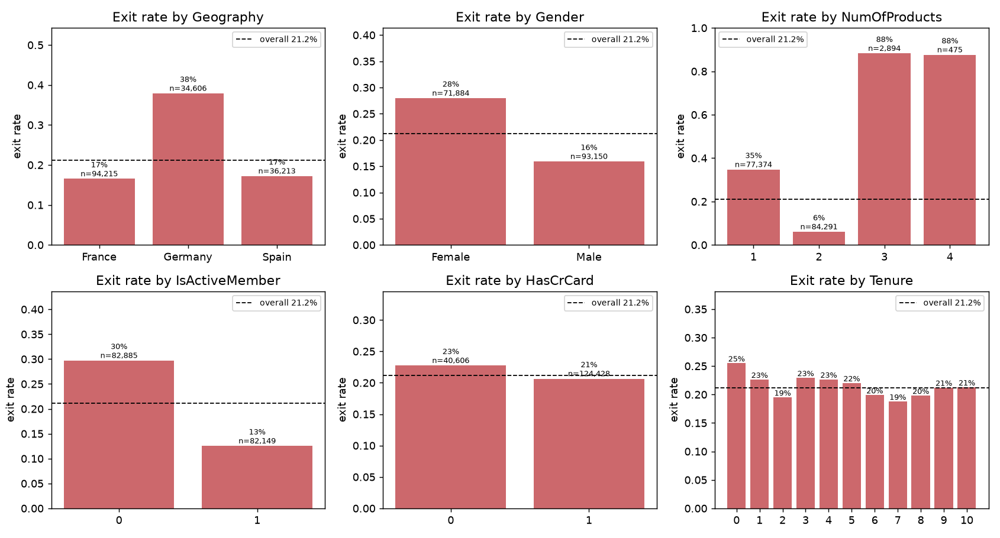
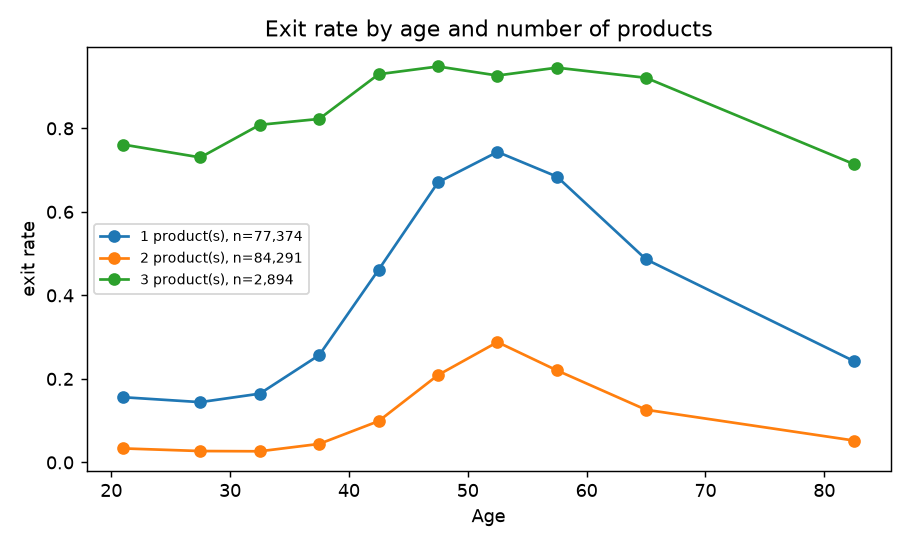
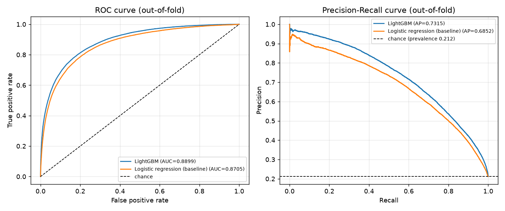
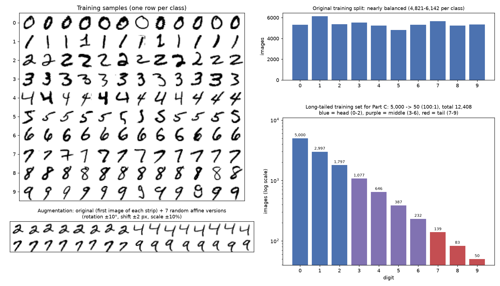
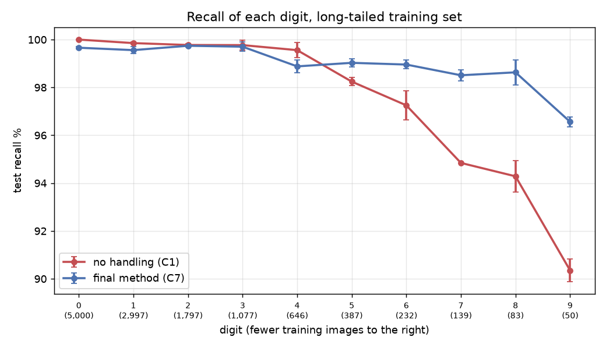

# FIT 面試作業 - 范佐搖

三個題目各放在一個資料夾,這一頁先放結果,細節在各題自己的說明裡。

- [Task 1 一般問答](task1_general/README.md)
- [Task 2 機器學習](task2_ml/README.md)
- [Task 3 電腦視覺](task3_cv/README.md)

## Task 2:預測客戶流失的機率

目標:用 `train.csv` 訓練模型,預測 `test.csv` 每位客戶離開銀行(`Exited`)的機率,並且評估模型、畫圖呈現。

資料:

| 項目 | 內容 |
|---|---|
| 一筆資料 | 一位銀行客戶 |
| 筆數 | 訓練 165,034 筆、測試 110,023 筆,沒有缺值 |
| 要預測的目標 | `Exited`,1 代表離開,佔 21.2% |
| 可以用的欄位 | 10 個客戶屬性(下表) |
| 沒有用的欄位 | `id`、`CustomerId`、`Surname`,是識別用的 |

先看每個欄位跟流失率的關係(整體是 21.2%):

| 欄位 | 意思 | 流失率 | 有沒有差 |
|---|---|---|---|
| `NumOfProducts` | 持有幾個產品 | 1 個 35%、2 個 6%、3 個以上 88% | 差很多,而且不是越多越高 |
| `Age` | 年齡 | 30 歲以下 8%、41 到 50 歲 39%、51 到 60 歲 61%、60 歲以上 31% | 差很多,中間最高 |
| `IsActiveMember` | 是不是活躍會員 | 不活躍 30%、活躍 13% | 有差 |
| `Geography` | 國家 | 德國 38%、法國 17%、西班牙 17% | 德國特別高 |
| `Balance` | 帳戶餘額 | 餘額是 0 的 16%、有餘額的 27% | 有差 |
| `Gender` | 性別 | 女 28%、男 16% | 有差 |
| `CreditScore` | 信用分數 | 分數最低的四分之一 23%、最高的四分之一 20% | 差一點點 |
| `HasCrCard` | 有沒有信用卡 | 沒有 23%、有 21% | 幾乎沒差 |
| `EstimatedSalary` | 估計年薪 | 各薪資區間都在 20% 到 23% | 幾乎沒差 |
| `Tenure` | 往來幾年 | 各年數都在 19% 到 25% | 幾乎沒差 |



影響最大的兩個欄位(產品數和年齡)跟流失率的關係都不是一直線,放在一起看更明顯:



所以我預期樹模型會比線性模型適合,後面的比較也確實是這樣。

看完資料之後先比了四種模型,都用同一套 5-fold 交叉驗證。指標主要看 AUC,因為要交的是機率:

| 模型 | AUC |
|---|---|
| 邏輯迴歸 | 0.8705 |
| Random forest | 0.8869 |
| XGBoost | 0.8897 |
| LightGBM | 0.8899 |

XGBoost 和 LightGBM 一樣好,我選 LightGBM。之後試了調參數、加 class weight、自己做特徵、跟 XGBoost 平均,都沒有再進步,所以就定案了。

定案模型的 AUC 是 0.8899。把機率切成會不會流失的話,門檻用 0.32,F1 是 0.665(precision 0.637、recall 0.695)。



`test.csv` 的預測在 [task2_ml/outputs/predictions.csv](task2_ml/outputs/predictions.csv)。

## Task 3:MNIST 數字分類

目標:用 CNN 做手寫數字分類,並且在模型設計、優化、類別不平衡三件事上有所展現。

資料:

| 項目 | 內容 |
|---|---|
| 一筆資料 | 一張 28x28 的灰階手寫數字圖,像素值 0 到 255 |
| 要預測的目標 | 圖上寫的是哪個數字,0 到 9 共 10 類 |
| 筆數 | 官方訓練 60,000 張、測試 10,000 張 |
| 我的切法 | 訓練 54,000、驗證 6,000(每個數字 600 張)、測試 10,000 |
| 像素的樣子 | 81% 的像素是 0(背景),有筆畫的地方只佔兩成左右 |

每個數字有幾張。前兩欄是原本的資料,最後一欄是我為了類別不平衡的實驗另外做的訓練集:

| 數字 | 官方訓練集 | 測試集 | 不平衡實驗用的訓練集 |
|---|---|---|---|
| 0 | 5,923 | 980 | 5,000 |
| 1 | 6,742 | 1,135 | 2,997 |
| 2 | 5,958 | 1,032 | 1,797 |
| 3 | 6,131 | 1,010 | 1,077 |
| 4 | 5,842 | 982 | 646 |
| 5 | 5,421 | 892 | 387 |
| 6 | 5,918 | 958 | 232 |
| 7 | 6,265 | 1,028 | 139 |
| 8 | 5,851 | 974 | 83 |
| 9 | 5,949 | 1,009 | 50 |

原本的資料每個數字都在五、六千張,最多的(1)和最少的(5)只差 1.2 倍,是平衡的。所以題目要的類別不平衡得自己做:我讓張數從數字 0 的 5,000 張一路遞減到數字 9 的 50 張,差 100 倍。

下面是資料的樣子。左上是每個數字的樣本,左下是 augmentation 之後的效果,右邊是兩種訓練集的張數分布。



看圖可以發現同一個數字的寫法差很多(像 7 有沒有中間那一橫、4 上面有沒有封起來),有些數字本來就長得像(4 和 9、3 和 5)。後面模型錯的也大多是這幾組。

題目指定的三件事各做一組實驗,每組都從 baseline 開始一次改一個東西,用驗證集比較,每個設定跑 3 個 seed。

| | 試了什麼 | 最後用的 | 效果 |
|---|---|---|---|
| 模型 | LeNet-5、加深的 CNN、加 BN、加 dropout 和 augmentation | DigitNet + BN + dropout + augmentation | 測試錯誤 73 張降到 43 張(每一萬張) |
| 優化 | SGD、momentum、Adam、AdamW,固定學習率和 one-cycle | AdamW + one-cycle | 錯誤率 1.9% 降到 0.5% |
| 類別不平衡 | class weight、平衡抽樣、focal loss、logit adjustment | Logit-adjusted loss + augmentation | 準確率 97.4% 拉回 98.9% |

定案的模型有 72,666 個參數,測試準確率 99.64%(一萬張錯 36 張)。

類別不平衡的部分,數字 0 留 5,000 張,一路遞減到數字 9 只有 50 張。不處理的話數字 9 的 recall 只有 90.4%,定案的做法可以拉到 96.6%。下圖每條線是一種處理方法,橫軸是數字(越右邊訓練資料越少),縱軸是測試的 recall。



## 怎麼跑

```bash
pip install -r requirements.txt
cd task2_ml && python main.py                    # 約 1 分半
cd ../task3_cv && python main.py --workers 3    # 有 GPU 約 8 分鐘,只有 CPU 會很久
```

結果我都跑好放在各題的 `outputs/` 了,不重跑也可以直接看。
