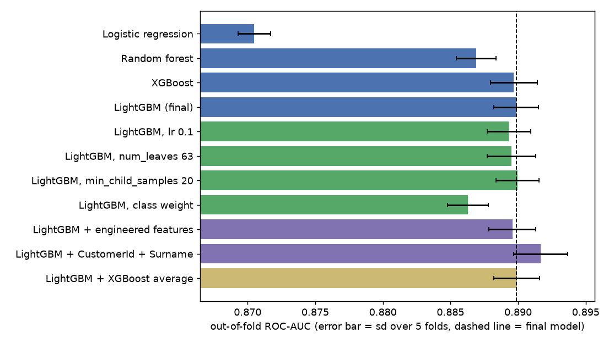
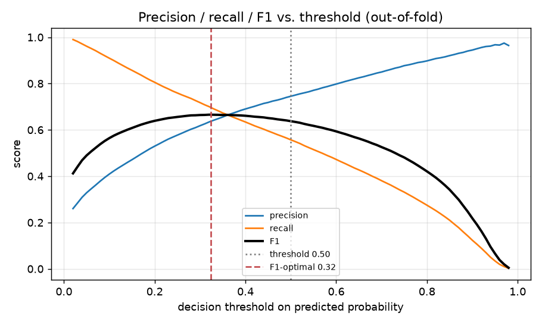
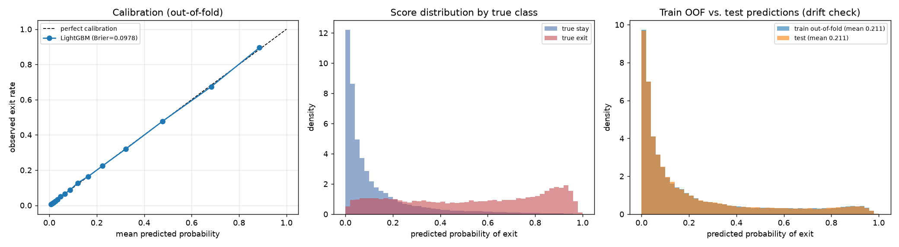
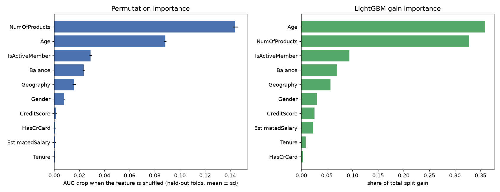

# Task 2:預測客戶流失的機率

## 題目和目標

題目給了一份銀行客戶的資料。`train.csv` 有每位客戶的基本資料和最後有沒有離開(`Exited`),`test.csv` 只有基本資料。要做的事情是:

1. 預測 `test.csv` 每位客戶 `Exited` 的機率,存成 CSV
2. 評估模型的預測能力
3. 畫圖呈現資料和預測的結果

題目沒有指定要用哪個指標。因為要交的是機率,我主要看 AUC(模型能不能把會流失的排在前面)和 log loss(機率本身準不準),需要切成會/不會流失的時候再看 F1 和 confusion matrix。

我最後用的是 LightGBM,5-fold 交叉驗證的 AUC 是 0.890。如果要把機率切成會不會流失,門檻設在 0.32 左右 F1 最高(0.665)。

## 怎麼跑

```bash
pip install -r ../requirements.txt
python main.py           # 定案的流程,大概一分半
python experiments.py    # 定案前試過的做法,大概兩分鐘
```

預測結果在 `outputs/predictions.csv`(`Exited` 是機率,`Exited_label` 是用門檻切過的 0/1),評估指標和圖也都在 `outputs/`。

## 資料

訓練資料 165,034 筆、測試 110,023 筆,一筆是一位客戶,沒有缺值。題目沒有附欄位說明,下面是我依欄位名稱和內容的理解:

| 欄位 | 意思 | 內容 |
|---|---|---|
| `id` | 資料的流水號 | 訓練和測試不重複 |
| `CustomerId` | 客戶編號 | 訓練集有 23,221 個不同的值,同一個編號會出現很多次 |
| `Surname` | 姓氏 | 2,797 種 |
| `CreditScore` | 信用分數 | 350 到 850,平均 656 |
| `Geography` | 國家 | 法國 57%、西班牙 22%、德國 21% |
| `Gender` | 性別 | 男 56%、女 44% |
| `Age` | 年齡 | 18 到 92 歲,平均 38 |
| `Tenure` | 跟銀行往來幾年 | 0 到 10 |
| `Balance` | 帳戶餘額 | 0 到 25 萬,有 54% 的人是 0 |
| `NumOfProducts` | 持有幾個銀行產品 | 1 到 4,九成八的人是 1 或 2 個 |
| `HasCrCard` | 有沒有信用卡 | 75% 有 |
| `IsActiveMember` | 是不是活躍會員 | 一半一半 |
| `EstimatedSalary` | 估計年薪 | 接近 0 到 20 萬,平均 11 萬 |
| `Exited` | 有沒有離開銀行(要預測的目標) | 1 是離開,佔 21.2% |

前三個是識別用的欄位,中間十個是可以拿來預測的客戶屬性。

有兩件事是看資料時注意到、後面會影響做法的。第一,流失的只佔兩成,所以不能看 accuracy(全部猜不會流失就有 79%)。第二,同一個 `CustomerId` 出現很多次但內容不一樣,所以一筆資料不完全等於一位獨立的客戶,這點我在最後有另外檢查。

## 資料裡看到的事

接著看每個欄位跟流失率的關係。下面每一格是一個欄位,長條是該類別的流失率,虛線是整體的 21.2%,長條比虛線高就表示這群人比較容易流失。


最明顯的是持有產品數。有 2 個產品的客戶流失率只有 6%,1 個產品是 35%,3 個以上直接到 88%。這個關係不是越多越高或越多越低,線性模型直接吃這個數字會學不好。

其他比較有差的:非活躍會員 30% 對活躍會員 13%;德國 38%,法國和西班牙都是 17% 左右;女性 28%、男性 16%。有沒有信用卡和往來年數幾乎看不出差別。數值欄位裡年齡差最多,流失的客戶年紀明顯比較大(中位數 44 歲對 36 歲)。


把年齡和產品數放在一起看,流失率在 50 到 55 歲最高,再老又降下來,而且不同產品數的水準差很多。看到這張圖我就猜樹模型會比較適合。

## 試過的做法

下面都是用同樣的 stratified 5-fold 跑的,指標用 out-of-fold 的預測算(每一筆的預測來自沒看過它的模型)。± 後面是五個 fold 之間的標準差。程式在 `experiments.py`。



先比模型:

| 模型 | AUC | Log loss |
|---|---|---|
| 邏輯迴歸 | 0.8705 ± 0.0012 | 0.3442 |
| Random forest | 0.8869 ± 0.0015 | 0.3238 |
| XGBoost | 0.8897 ± 0.0017 | 0.3191 |
| LightGBM | 0.8899 ± 0.0016 | 0.3189 |

邏輯迴歸明顯比較差,跟看資料時猜的一樣。換成 random forest 好很多,gradient boosting 再往上一點。XGBoost 和 LightGBM 只差 0.0002,比 fold 之間的波動小很多,等於一樣好。

選定 LightGBM 之後,我試著再往上推:

| 做法 | AUC | 結果 |
|---|---|---|
| 換幾組參數(learning rate、num_leaves、min_child_samples) | 0.8893 到 0.8900 | 沒差 |
| 加 class weight | 0.8863 | 變差,log loss 從 0.319 變 0.410 |
| 加自己做的特徵(餘額除以薪資、年齡乘產品數等 5 個) | 0.8896 | 沒差 |
| 跟 XGBoost 的預測平均 | 0.8899 | 沒差 |
| 加 CustomerId 和 Surname | 0.8917 | 有變好,但我沒有採用 |

除了最後一項,其他都沒有再進步,所以我判斷 0.890 大概就是這 10 個欄位能做到的程度。

## 定案

LightGBM,用原本的 10 個欄位,`Geography` 和 `Gender` 當類別特徵。幾個決定的理由:

模型選 LightGBM 而不是 XGBoost,只是因為它訓練比較快、類別欄位可以直接丟進去,兩個的表現其實分不出來。

不加 class weight。加了之後預測出來的機率整個被往上拉,而題目要的是機率。不平衡的問題我留到要分類的時候用門檻處理。

`CustomerId` 和 `Surname` 不用。這個我有猶豫過,因為加了 AUC 會多 0.002(測試集有 94% 的 CustomerId 在訓練集出現過)。但客戶編號和姓氏照理說不該影響一個人會不會流失,模型如果是靠記這些東西拿分,遇到新客戶就沒用了,而且用姓氏做預測在實務上也有爭議。

驗證的細節:early stopping 是從訓練的那四份裡再切 10% 出來用,沒有直接用驗證那一份,不然分數會偏高。門檻也是一樣的想法,每個 fold 的門檻用另外四個 fold 決定,五次選出來都在 0.32 到 0.33 之間。測試集的預測是五個 fold 的模型取平均。

## 結果

| 模型 | 門檻 | AUC | PR-AUC | Log loss | Accuracy | Precision | Recall | F1 |
|---|---|---|---|---|---|---|---|---|
| LightGBM(定案) | 0.50 | 0.8899 | 0.7315 | 0.3189 | 0.8659 | 0.7451 | 0.5570 | 0.6375 |
| LightGBM(定案) | 0.32 | 0.8899 | 0.7315 | 0.3189 | 0.8518 | 0.6373 | 0.6948 | 0.6648 |
| 邏輯迴歸(對照) | 0.50 | 0.8705 | 0.6852 | 0.3442 | 0.8560 | 0.7261 | 0.5130 | 0.6012 |


Confusion matrix(列是實際、欄是預測):

| | 預測留下 | 預測流失 |
|---|---|---|
| 門檻 0.50,實際留下 | 123,458 | 6,655 |
| 門檻 0.50,實際流失 | 15,470 | 19,451 |
| 門檻 0.32,實際留下 | 116,307 | 13,806 |
| 門檻 0.32,實際流失 | 10,659 | 24,262 |

用 0.5 當門檻的話,實際流失的客戶有 44% 抓不到。降到 0.32 可以多抓 4,811 人,不過誤判也多了 7,151 人。門檻要放哪裡其實要看挽留一個客戶的成本和流失一個客戶的損失,F1 只是在不知道這些數字時的折衷。



機率本身準不準我也看了一下。左邊的校準曲線幾乎貼著對角線,模型說 30% 的那群人實際上也差不多 30% 流失。右邊是訓練集和測試集的預測分布,兩個幾乎一樣,所以我認為測試集上的表現應該跟交叉驗證差不多。



特徵重要度跟一開始看資料的印象一致。把產品數打亂 AUC 會掉 0.144,年齡掉 0.088,再來是是否活躍、餘額、國家、性別,其他幾乎沒影響。



其他的圖(目標分布、數值欄位分布、confusion matrix、學習曲線)在 `outputs/` 裡。

## 其他想說的

test.csv 沒有答案,所以上面的數字都是交叉驗證估的。

資料裡同一個 `CustomerId` 會出現很多次而且內容不一樣,我擔心這樣切 fold 會不會有洩漏,所以另外用 CustomerId 分組再切一次(同一個 ID 不會同時在訓練和驗證),AUC 是 0.8894,跟原本差不多,應該沒有問題。這段檢查沒有放在程式裡。

模型有用到性別和國家。如果真的要拿來決定對客戶做什麼,這兩個欄位能不能用需要另外討論。

模型這邊我覺得已經到頂了,要再進步應該是要有新的資料(例如交易紀錄、客服紀錄)。
