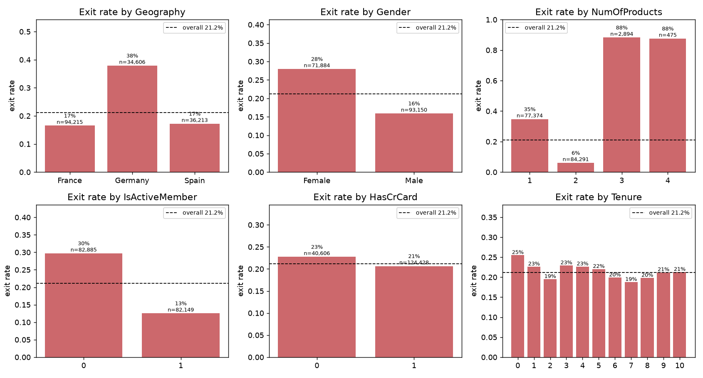
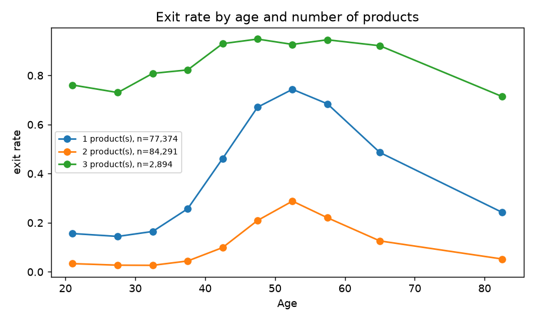
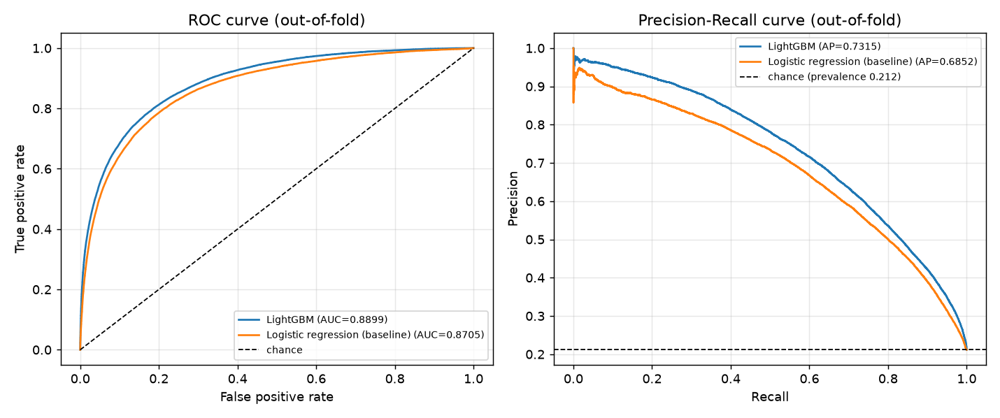
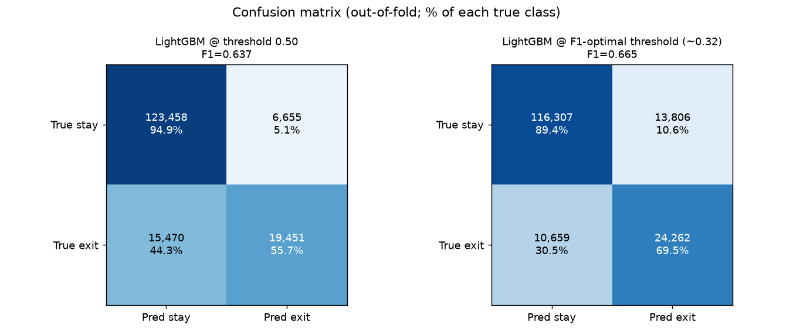

# Task 2:預測客戶流失的機率

## 題目和目標

題目給了一份銀行客戶的資料。`train.csv` 有每位客戶的基本資料和最後有沒有離開(`Exited`),`test.csv` 只有基本資料。要做的是預測 `test.csv` 每位客戶離開的機率,評估模型,並且畫圖呈現。

題目沒有指定指標。因為要交的是機率,我主要看 AUC,需要切成會/不會離開的時候再看 F1。

我最後用的是 LightGBM,5-fold 交叉驗證的 AUC 是 0.890。

## 怎麼跑

```bash
pip install -r ../requirements.txt
python main.py           # 定案的流程,大概一分半
python experiments.py    # 定案前試過的做法,大概兩分鐘
```

預測結果在 `outputs/predictions.csv`(`Exited` 是機率,`Exited_label` 是用門檻切過的 0/1),評估指標和圖也都在 `outputs/`。

## 資料

訓練 165,034 筆、測試 110,023 筆,一筆是一位客戶,沒有缺值。離開的客戶佔 21.2%。

| 欄位 | 意思 |
|---|---|
| `id`、`CustomerId`、`Surname` | 流水號、客戶編號、姓氏(沒有使用) |
| `CreditScore` | 信用分數 |
| `Geography` | 國家(法國、西班牙、德國) |
| `Gender` | 性別 |
| `Age` | 年齡 |
| `Tenure` | 跟銀行往來幾年 |
| `Balance` | 帳戶餘額 |
| `NumOfProducts` | 持有幾個銀行產品 |
| `HasCrCard` | 有沒有信用卡 |
| `IsActiveMember` | 是不是活躍會員 |
| `EstimatedSalary` | 估計年薪 |
| `Exited` | 有沒有離開銀行,要預測的目標 |

下面每一格是一個欄位,長條是該類別離開的比例,虛線是全體的 21.2%。



最明顯的是持有產品數:2 個產品的只有 6% 離開,1 個產品是 35%,3 個以上到 88%。其他有差的是活躍與否、國家(德國特別高)、性別。



年齡也很有影響,50 到 55 歲離開的比例最高。產品數和年齡的關係都不是一直線,所以我猜樹模型會比線性模型適合。

## 試過的做法

都用同樣的 5-fold 交叉驗證來比。程式在 `experiments.py`。


先比模型:

| 模型 | AUC |
|---|---|
| 邏輯迴歸 | 0.8705 |
| Random forest | 0.8869 |
| XGBoost | 0.8897 |
| LightGBM | 0.8899 |

邏輯迴歸明顯比較差,樹模型好很多。XGBoost 和 LightGBM 幾乎一樣。

選定 LightGBM 之後再試著往上推:

| 做法 | AUC | 結果 |
|---|---|---|
| 換幾組參數 | 0.8893 到 0.8900 | 沒差 |
| 加 class weight | 0.8863 | 變差 |
| 加自己做的特徵 | 0.8896 | 沒差 |
| 跟 XGBoost 的預測平均 | 0.8899 | 沒差 |
| 加客戶編號和姓氏 | 0.8917 | 有變好,但沒有採用 |

除了最後一項,其他都沒有再進步,所以我判斷 0.890 大概就是這些欄位能做到的程度。

## 定案

LightGBM,用原本的 10 個欄位。

- 選 LightGBM 而不是 XGBoost,是因為它訓練比較快,兩個的表現分不出來。
- 不加 class weight,因為加了之後預測的機率會整個偏高,而題目要的是機率。
- 不用客戶編號和姓氏。加了分數會高一點,但這兩個欄位照理說跟會不會離開無關,模型靠它們拿分等於在背資料,遇到新客戶就沒用了。

## 結果

| 模型 | AUC | 門檻 | Precision | Recall | F1 |
|---|---|---|---|---|---|
| LightGBM(定案) | 0.8899 | 0.50 | 0.745 | 0.557 | 0.637 |
| LightGBM(定案) | 0.8899 | 0.32 | 0.637 | 0.695 | 0.665 |
| 邏輯迴歸(對照) | 0.8705 | 0.50 | 0.726 | 0.513 | 0.601 |



用 0.5 當門檻的話,實際離開的客戶有 44% 抓不到。把門檻降到 0.32(F1 最高的地方)可以多抓到一些,代價是誤判也變多。



哪些欄位最重要,跟一開始看資料的印象一致:產品數和年齡影響最大,再來是是否活躍、餘額、國家、性別。


`test.csv` 沒有答案,所以上面的數字都是交叉驗證估出來的。其他的圖在 `outputs/` 裡。
