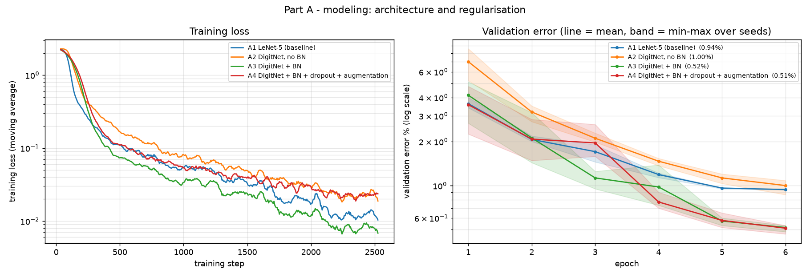
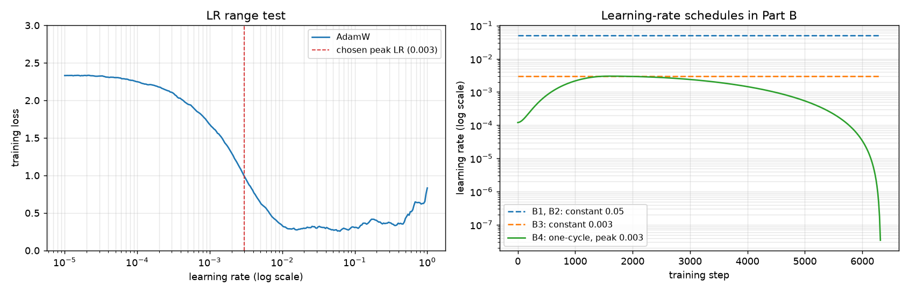
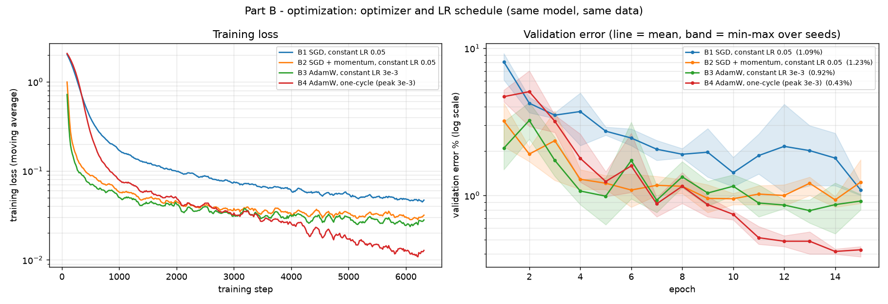
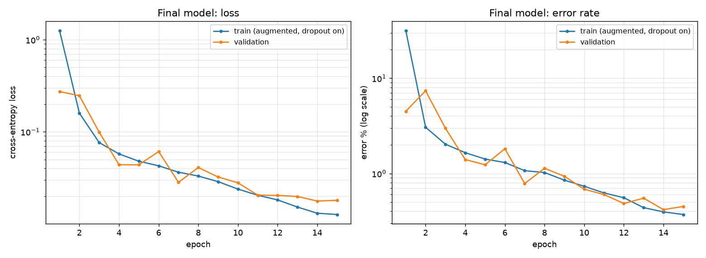
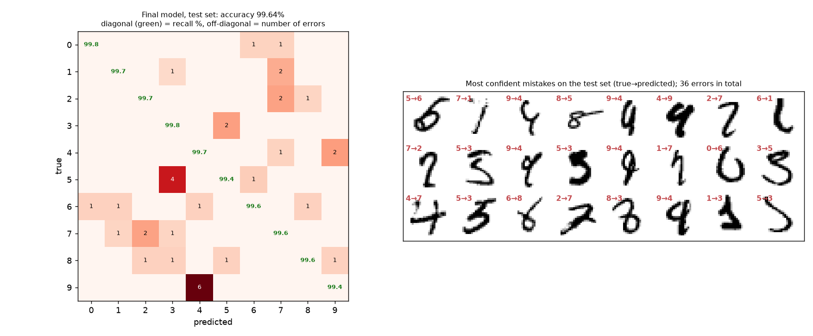
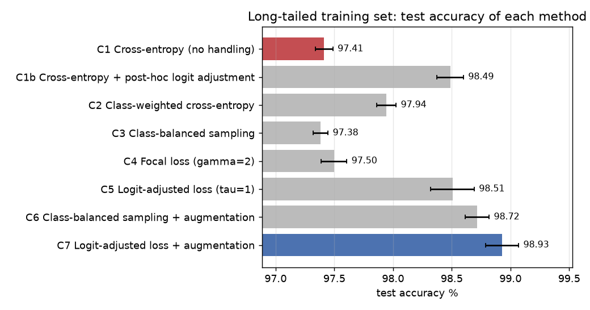
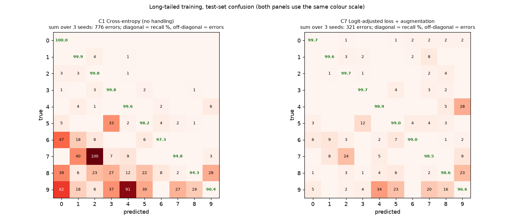

# Task 3:MNIST 數字分類

## 題目和目標

用 CNN 做 MNIST 手寫數字分類,而且要在三件事上有所展現:模型設計、優化、類別不平衡的處理。另外要有圖呈現資料和訓練、預測的結果。

MNIST 是 0 到 9 的手寫數字,每張圖是 28x28 的灰階影像(像素值 0 到 255),標籤是它寫的是哪個數字。官方分成 60,000 張訓練和 10,000 張測試。每個數字的張數差不多(訓練集每類 5,421 到 6,742 張),所以它本身是平衡的資料,題目要的類別不平衡得自己做出來。

目標我設成兩個:

1. 在原本平衡的資料上,用小模型把準確率做高,並且說得出每個設計是不是真的有幫助
2. 把訓練資料改成不平衡之後,讓樣本少的數字也認得好

評估的時候,平衡的情況看測試準確率就夠了。不平衡的情況要拆開看每個數字的 recall,因為整體準確率會被樣本多的數字撐住。

## 做法

我的做法是三件事各做一組實驗(程式裡叫 Part A、B、C),每一組都是從一個 baseline 開始,一次改一個東西,用驗證集比較,比完再決定要用哪個。三組選出來的設定合起來就是最後定案的模型。總共訓練了 58 次,全部寫在 `main.py`。

| | 試了什麼 | 最後用的 | 效果 |
|---|---|---|---|
| Part A 模型 | LeNet-5、加深的 CNN、加 BN、加 dropout 和 augmentation | DigitNet + BN + dropout + augmentation | 測試錯誤 73 張降到 43 張(每一萬張) |
| Part B 優化 | SGD、momentum、Adam、AdamW,固定學習率和 one-cycle,共 8 種 | AdamW + one-cycle | 錯誤率 1.9% 降到 0.5% |
| Part C 類別不平衡 | class weight、平衡抽樣、focal loss、logit adjustment 等 8 種 | Logit-adjusted loss + augmentation | 準確率 97.4% 拉回 98.9% |

定案的模型有 72,666 個參數,在完整的資料上訓練 15 個 epoch,測試準確率 99.64%(一萬張錯 36 張)。

## 怎麼跑

```bash
pip install -r ../requirements.txt
python main.py --workers 3    # 有 GPU,大概 8 分鐘
python main.py --quick        # 只想確認程式能動,1 分鐘
```

沒有 GPU 也能跑(`python main.py`),只是會很久,建議直接看 `outputs/` 裡我跑好的結果。表格的數字來自 `outputs/summary.md`。

## 資料怎麼切

MNIST 的 60,000 張訓練資料我切成 54,000 張訓練、6,000 張驗證(每個數字 600 張)。要選什麼設定都看驗證集,官方的 10,000 張測試集只在最後報數字的時候用。

每個設定都用 3 個 seed 各訓練一次,表格裡是平均和標準差。seed 之間大概會差 0.05%,所以 0.1% 以內的差距我不會當成真的有差。另外每個模型都是用最後一個 epoch 的結果,沒有挑最好的 checkpoint。


Augmentation 用的是小幅度的旋轉、平移、縮放。沒有做翻轉,因為數字翻過來就不是原本的數字了。

## Part A:模型

Baseline 用 LeNet-5,然後一步一步改:

| 模型 | 參數量 | 驗證準確率 % | 測試準確率 % | 測試錯誤數 |
|---|---|---|---|---|
| A1 LeNet-5 | 61,706 | 99.06 ± 0.01 | 99.27 ± 0.02 | 73 |
| A2 DigitNet(沒有 BN) | 72,442 | 99.00 ± 0.12 | 99.15 ± 0.02 | 85 |
| A3 DigitNet + BN | 72,666 | 99.48 ± 0.03 | 99.56 ± 0.03 | 44 |
| A4 DigitNet + BN + dropout + augmentation | 72,666 | 99.49 ± 0.04 | 99.57 ± 0.02 | 43 |

我自己設計的模型叫 DigitNet,結構是這樣:

```
輸入 1x28x28
[conv3x3(16) + BN + ReLU] x2 -> maxpool    28 -> 14
[conv3x3(32) + BN + ReLU] x2 -> maxpool    14 -> 7
[conv3x3(64) + BN + ReLU] x2
global average pooling -> dropout 0.2 -> linear(64 -> 10)
```

想法是用兩層 3x3 取代 LeNet 的 5x5,最後用 global average pooling 取代 LeNet 那個很大的全連接層(LeNet 有 78% 的參數在那一層)。寬度選 16-32-64 是故意讓參數量跟 LeNet 差不多,這樣比較的是結構而不是模型大小。



跑出來有幾個我原本沒預期的地方。

單純把網路加深(A2)並沒有比 LeNet 好,甚至差一點,訓練也比較慢。真正有差的是 BatchNorm,加上去之後錯誤數從 85 掉到 44,幾乎少一半。

Dropout 和 augmentation 在這裡看不出效果(99.57 對 99.56)。訓練 loss 有變高(0.023 對 0.008),表示它們有在作用,只是 MNIST 資料夠多,6 個 epoch 本來就沒什麼 overfitting。我還是留著,因為到 Part C 資料變少的時候,augmentation 的幫助就很明顯。

## Part B:優化

這部分模型固定用 A4,只換優化器和學習率的設定。

學習率是先做 LR range test 決定的:把學習率從很小慢慢調大,看 loss 什麼時候開始不降或爆掉。AdamW 的 loss 在 1e-2 到 1e-1 之間最低,我取保守一點的 3e-3 當最高點;SGD 加 momentum 是在 0.3 到 2 之間最低,我取 0.2。



排程用的是 one-cycle,就是學習率先從小拉到最高點,再慢慢降到接近 0。為了確定差別真的來自排程,我另外放了對照組:同一個優化器、同樣的最高學習率,但全程固定不變(B3 對 B4、B7 對 B8)。

| 設定 | 第 1 個 epoch 後驗證準確率 % | 最後驗證準確率 % | 測試準確率 % |
|---|---|---|---|
| B1 SGD,固定 0.05 | 91.01 ± 2.55 | 97.70 ± 0.39 | 98.13 ± 0.41 |
| B2 SGD + momentum,固定 0.05 | 97.04 ± 0.72 | 98.86 ± 0.16 | 98.91 ± 0.33 |
| B3 SGD + momentum,固定 0.2 | 96.99 ± 0.63 | 98.43 ± 0.35 | 98.45 ± 0.48 |
| B4 SGD + momentum,one-cycle 最高 0.2 | 85.41 ± 17.47 | 99.51 ± 0.05 | 99.57 ± 0.03 |
| B5 Adam,固定 1e-3 | 97.11 ± 0.66 | 98.79 ± 0.20 | 98.98 ± 0.33 |
| B6 AdamW,固定 1e-3 | 97.54 ± 0.38 | 98.71 ± 0.32 | 99.00 ± 0.27 |
| B7 AdamW,固定 3e-3 | 98.01 ± 0.42 | 98.42 ± 0.63 | 98.51 ± 0.81 |
| B8 AdamW,one-cycle 最高 3e-3 | 96.84 ± 0.69 | 99.49 ± 0.06 | 99.51 ± 0.07 |



加 momentum 有幫助,錯誤率從 1.87% 降到 1.09%。

但差最多的是排程。SGD 從固定 0.2 換成 one-cycle,錯誤率從 1.55% 變 0.43%;AdamW 從 1.49% 變 0.49%。兩邊都是降到原本的三分之一。固定學習率就算調低一點(B2、B6)也還是卡在 1% 左右,而且每次跑出來的結果差很多。

Adam 和 AdamW 在固定學習率下沒有差別。

調好的 SGD 和 AdamW 最後一樣好(99.57 對 99.51,在誤差範圍內)。不過 SGD 的 one-cycle 有一個 seed 在一開始很不穩,第一個 epoch 驗證準確率只有 65%,雖然後來有追回來。AdamW 三次都很平順,所以後面我都用 AdamW 加 one-cycle。

其他設定:weight decay 只加在 conv 和 linear 的 weight 上,BN 和 bias 不加。SGD 和 Adam 用 5e-4,AdamW 用 5e-2(兩種的算法不一樣,不能用同一個數字)。Batch size 128。

## 定案的模型

把 Part A 和 Part B 選出來的東西合在一起:

- 架構:DigitNet(有 BN),dropout 0.2
- 資料:加 augmentation
- 優化:AdamW,one-cycle,最高學習率 3e-3,batch size 128

選的依據都是驗證集的準確率。兩個做法如果差距在 seed 的波動範圍內(像 SGD 和 AdamW),就選訓練過程比較穩的。

前面的比較每個只訓練 6 個 epoch,定案之後我把它拉長到 15 個 epoch。測試準確率 99.64%,驗證 99.47%。每個數字的 recall 都在 99.4% 以上。權重存在 `outputs/digitnet_final.pt`,用 `DigitNet()` 加 `load_state_dict` 就可以載入。



訓練和驗證的曲線很接近,沒有 overfitting。一開始訓練的 loss 比驗證還高,是因為訓練時有開 augmentation 和 dropout。

右邊那張是模型的信心分布。答對的有 99.2% 信心超過 0.95,答錯的 36 張裡只有 6 張超過。如果實際要用,可以把信心低的挑出來給人看。



剩下錯的大多是 9 和 4、5 和 3 這種,有些我自己看也不太確定是什麼。

## Part C:類別不平衡

MNIST 每個數字的數量差不多,所以不平衡要自己做。我讓數字 0 留 5,000 張,之後每個數字遞減,到數字 9 只剩 50 張,總共 12,408 張(分布在最上面那張圖)。驗證集和測試集不動。

比較的方法:

| 代號 | 方法 | 說明 |
|---|---|---|
| C1 | 不處理 | 一般的 cross-entropy |
| C1b | 事後調整 logit | 模型跟 C1 一樣,預測時把 logit 減掉 log(類別比例),不用重新訓練 |
| C2 | Class weight | loss 依類別數量的倒數加權 |
| C3 | 平衡抽樣 | 用 WeightedRandomSampler,讓每個類別被抽到的機率一樣 |
| C4 | Focal loss | gamma = 2 |
| C5 | Logit-adjusted loss | 訓練時把 logit 加上 log(類別比例) |
| C6 | C3 + augmentation | |
| C7 | C5 + augmentation | |

結果(驗證那一欄是用來選方法的,其他是測試集;頭部是數字 0 到 2,尾部是 7 到 9,完整的表在 `outputs/summary.md`):

| 方法 | 驗證 balanced acc % | 測試準確率 % | 頭部 recall % | 尾部 recall % | 數字 9 recall % |
|---|---|---|---|---|---|
| C1 不處理 | 97.40 ± 0.03 | 97.41 ± 0.08 | 99.88 ± 0.03 | 93.16 ± 0.06 | 90.35 ± 0.47 |
| C1b 事後調整 logit | 98.31 ± 0.08 | 98.49 ± 0.11 | 99.66 ± 0.11 | 96.65 ± 0.41 | 95.21 ± 0.51 |
| C2 Class weight | 97.82 ± 0.09 | 97.94 ± 0.08 | 99.76 ± 0.02 | 94.87 ± 0.17 | 92.01 ± 0.32 |
| C3 平衡抽樣 | 97.20 ± 0.06 | 97.38 ± 0.06 | 99.82 ± 0.07 | 93.00 ± 0.37 | 90.16 ± 0.99 |
| C4 Focal loss | 97.24 ± 0.11 | 97.50 ± 0.11 | 99.90 ± 0.02 | 93.39 ± 0.30 | 90.88 ± 1.01 |
| C5 Logit-adjusted loss | 98.19 ± 0.17 | 98.51 ± 0.19 | 99.80 ± 0.11 | 96.58 ± 0.53 | 94.45 ± 0.88 |
| C6 平衡抽樣 + augmentation | 98.54 ± 0.03 | 98.72 ± 0.10 | 99.85 ± 0.03 | 96.97 ± 0.33 | 95.14 ± 0.77 |
| C7 Logit-adjusted loss + augmentation | 98.78 ± 0.13 | 98.93 ± 0.14 | 99.65 ± 0.08 | 97.90 ± 0.22 | 96.56 ± 0.21 |



下面這張把不處理(紅)和定案的做法(藍)拆開來看每個數字的 recall。橫軸括號裡是訓練張數,越右邊越少。


不處理的時候整體準確率還有 97.4%,看起來不差,但拆開來看數字 9 的 recall 只有 90.4%,頭部的數字則幾乎全對。所以這種情況只看 accuracy 會被騙,要拆開看每個類別的 recall。

錯的方向也很一致。下面左邊是不處理時的 confusion matrix,錯誤有 93% 在對角線下方,也就是少的數字被猜成多的數字(7 猜成 2 有 100 次、9 猜成 4 有 91 次),反過來很少。模型等於把哪個數字比較常出現也學進去了。



既然問題是模型偏向常見的類別,最直接的做法就是把這個偏向扣掉。C1b 完全沒有重新訓練,只是預測時調整 logit,錯誤就少了 41%(三個 seed 合計 776 降到 454)。把同樣的概念寫進 loss 裡訓練(C5)效果差不多。這個結果我蠻意外的,表示模型學到的特徵其實沒那麼差,主要是判斷的界線歪了。

平衡抽樣單獨用沒有效果(C3,97.38%)。我想原因是那 50 張 9 只是被重複抽很多次,模型把它們背起來而已。配上 augmentation 之後(C6)就跳到 98.72%,因為每次抽到的圖都有一點不一樣。

Focal loss 也沒用。它處理的是難分的樣本,但這裡訓練資料幾乎都分對了,問題出在類別少,不是樣本難。

所以不平衡這部分我定案用 C7(logit-adjusted loss 加 augmentation),它在驗證集上最高,測試準確率 98.93%。數字 9 的 recall 從 90.4% 到 96.6%,總錯誤少了 59%。代價是頭部類別掉了一點點(99.88% 到 99.65%)。

跟用完整資料訓練的 99.64% 比,C7 還是差了 0.7%。這段差距我認為就是資料量的問題,少掉的那幾千張圖沒辦法靠 loss 補回來。

## 一些限制

- Part C 各方法的參數(tau = 1、gamma = 2)都是用常見的預設值,沒有另外調。
- 3 個 seed 換的是模型初始值和資料順序,長尾的那份資料只抽了一次。
- 驗證集是平衡的,實際遇到不平衡的資料通常沒有這種條件。
- Part B 每個設定只訓練 6 個 epoch,訓練久一點差距可能會變小。
- 完整的實驗我只在 GPU 上跑完過。GPU 的計算順序不固定,重跑的數字會有一點點不同(0.05% 左右)。

## 參考資料

- LeCun et al., Gradient-based learning applied to document recognition, 1998
- Ioffe & Szegedy, Batch Normalization, 2015
- Smith, Cyclical learning rates for training neural networks, 2017
- Smith & Topin, Super-convergence, 2018
- Loshchilov & Hutter, Decoupled weight decay regularization, 2019
- Lin et al., Focal loss for dense object detection, 2017
- Menon et al., Long-tail learning via logit adjustment, 2021
