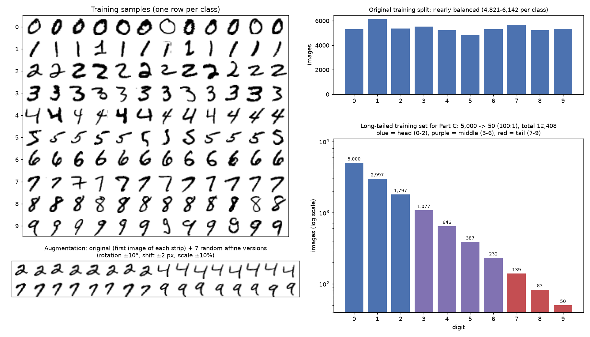
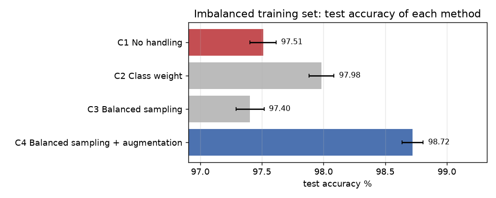
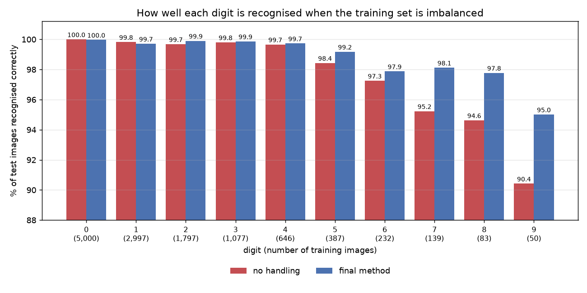
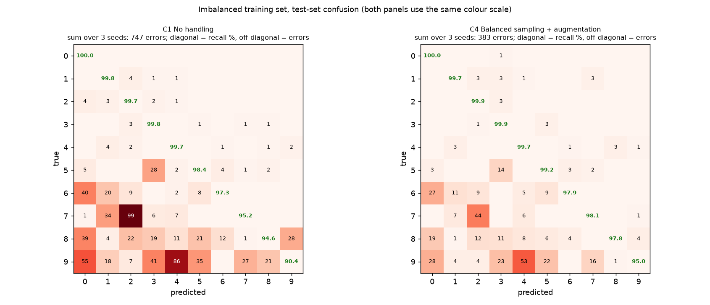

# Task 3:MNIST 數字分類

## 題目和目標

用 CNN 做 MNIST 手寫數字分類,而且要在三件事上有所展現:模型設計、優化、類別不平衡的處理。另外要有圖呈現資料和結果。

MNIST 是 0 到 9 的手寫數字,每張圖是 28x28 的灰階影像。官方分成 60,000 張訓練和 10,000 張測試,每個數字的張數差不多。

## 做法

三件事各做一組實驗(程式裡叫 Part A、B、C)。每一組都從最簡單的做法開始,一次改一個東西,比完再決定要用哪個。

| | 試了什麼 | 最後用的 | 效果 |
|---|---|---|---|
| Part A 模型 | LeNet-5、自己設計的 CNN、加 BN、加 dropout 和 augmentation | DigitNet + BN + dropout + augmentation | 測試錯誤 73 張降到 45 張(每一萬張) |
| Part B 優化 | SGD、加 momentum、AdamW、加學習率排程 | AdamW + one-cycle 排程 | 錯誤率 1.8% 降到 0.4% |
| Part C 類別不平衡 | class weight、平衡抽樣、平衡抽樣加 augmentation | 平衡抽樣 + augmentation | 準確率 97.5% 拉回 98.7% |

定案的模型有 72,666 個參數,測試準確率 99.63%(一萬張錯 37 張)。

## 怎麼跑

```bash
pip install -r ../requirements.txt
python main.py --workers 3    # 有 GPU,大概 5 分鐘
python main.py --quick        # 只想確認程式能動,1 分鐘
```

沒有 GPU 也能跑(`python main.py`),只是會很久,建議直接看 `outputs/` 裡我跑好的結果。表格的數字來自 `outputs/summary.md`。

## 資料怎麼切

60,000 張訓練資料我切成 54,000 張訓練、6,000 張驗證。要選什麼設定都看驗證集,官方的 10,000 張測試集只在最後報數字的時候用。

每個設定都換 3 個亂數種子各訓練一次,表格裡是平均和標準差。同一個設定重跑大概會差 0.05%,所以 0.1% 以內的差距我不會當成真的有差。



Augmentation 是訓練時把圖隨機轉一點、移一點、縮放一點。沒有做翻轉,因為數字翻過來就不是原本的數字了。

## Part A:模型

從 LeNet-5 開始,一步一步改:

| 模型 | 參數量 | 測試準確率 % | 測試錯誤數(每一萬張) |
|---|---|---|---|
| A1 LeNet-5 | 61,706 | 99.27 ± 0.04 | 73 |
| A2 DigitNet(沒有 BN) | 72,442 | 99.16 ± 0.02 | 84 |
| A3 DigitNet + BN | 72,666 | 99.53 ± 0.03 | 47 |
| A4 DigitNet + BN + dropout + augmentation | 72,666 | 99.55 ± 0.06 | 45 |

DigitNet 是我自己設計的,結構是這樣:

```
輸入 1x28x28
[conv3x3(16) + BN + ReLU] x2 -> maxpool    28 -> 14
[conv3x3(32) + BN + ReLU] x2 -> maxpool    14 -> 7
[conv3x3(64) + BN + ReLU] x2
global average pooling -> dropout 0.2 -> linear(64 -> 10)
```

想法是用比較多層的 3x3 卷積取代 LeNet 的 5x5,最後用 global average pooling 取代 LeNet 那個很大的全連接層。寬度選 16-32-64 是故意讓參數量跟 LeNet 差不多,這樣比的是結構而不是模型大小。


單純把網路加深(A2)並沒有比 LeNet 好。真正有差的是 BatchNorm,加上去之後錯誤數從 84 掉到 47,幾乎少一半。

Dropout 和 augmentation 在這裡看不出效果(99.55 對 99.53),因為 MNIST 資料夠多。我還是留著,因為到 Part C 資料變少的時候,augmentation 的幫助就很明顯。

## Part B:優化

模型固定用 A4,只換優化的方式:

| 設定 | 測試準確率 % | 錯誤率 % |
|---|---|---|
| B1 SGD,學習率固定 0.05 | 98.18 ± 0.34 | 1.82 |
| B2 SGD + momentum,學習率固定 0.05 | 99.03 ± 0.12 | 0.97 |
| B3 AdamW,學習率固定 3e-3 | 98.74 ± 0.40 | 1.26 |
| B4 AdamW,one-cycle 排程(最高 3e-3) | 99.56 ± 0.04 | 0.44 |


加 momentum 有幫助,錯誤率從 1.82% 降到 0.97%。

差最多的是學習率排程。One-cycle 是讓學習率先從小慢慢拉高,再慢慢降到接近 0。B3 和 B4 用的優化器和最高學習率都一樣,只差在有沒有排程,錯誤率就從 1.26% 降到 0.44%。固定學習率的幾組每次跑出來的結果也差比較多。

最高學習率 3e-3 是先做一個小測試決定的:把學習率從很小慢慢調大,看 loss 的變化,選在 loss 還在穩定下降的地方(下圖左)。


## 定案的模型

把 Part A 和 Part B 選出來的合在一起:DigitNet(有 BN)、dropout、augmentation、AdamW、one-cycle 排程。前面的比較每個只訓練 6 個 epoch,定案之後拉長到 15 個 epoch。

測試準確率 99.63%,驗證 99.55%。權重存在 `outputs/digitnet_final.pt`。


訓練和驗證的曲線很接近,沒有 overfitting。


剩下錯的 37 張大多是 9 和 4、2 和 7 這種,右邊列出來的有些我自己看也不太確定是什麼。

## Part C:類別不平衡

MNIST 每個數字的數量差不多,所以不平衡要自己做。我讓數字 0 留 5,000 張,之後每個數字遞減,到數字 9 只剩 50 張,總共 12,408 張(分布在最上面那張圖的右下角)。驗證集和測試集不動。

比較四種做法:

| 做法 | 說明 | 測試準確率 % | 數字 9 認對 % |
|---|---|---|---|
| C1 不處理 | 照一般的方式訓練 | 97.51 ± 0.11 | 90.4 |
| C2 Class weight | 張數少的數字,猜錯的時候罰比較重 | 97.98 ± 0.10 | 92.2 |
| C3 平衡抽樣 | 讓每個數字被抽到的機率一樣,張數少的會被重複抽 | 97.40 ± 0.11 | 90.1 |
| C4 平衡抽樣 + augmentation | 同上,但每次抽到的圖都會稍微變形 | 98.72 ± 0.09 | 95.0 |



不處理的時候整體準確率還有 97.5%,看起來不差,但拆開來看每個數字就不一樣了:

| 數字 | 訓練張數 | 不處理(C1) | 定案的做法(C4) |
|---|---|---|---|
| 0 | 5,000 | 100.0% | 100.0% |
| 1 | 2,997 | 99.8% | 99.7% |
| 2 | 1,797 | 99.7% | 99.9% |
| 3 | 1,077 | 99.8% | 99.9% |
| 4 | 646 | 99.7% | 99.7% |
| 5 | 387 | 98.4% | 99.2% |
| 6 | 232 | 97.3% | 97.9% |
| 7 | 139 | 95.2% | 98.1% |
| 8 | 83 | 94.6% | 97.8% |
| 9 | 50 | 90.4% | 95.0% |



張數多的數字幾乎全對,張數越少認得越差,數字 9 只認對 90.4%。所以資料不平衡的時候只看整體準確率會被騙,要拆開看每個類別。

錯的方向也很一致。下面左邊是不處理時的 confusion matrix,93% 的錯誤是把張數少的數字猜成張數多的數字(例如 7 猜成 2、9 猜成 4),反過來很少。



Class weight 有一點幫助。平衡抽樣單獨用沒有效果,我想原因是那 50 張 9 只是被重複抽很多次,模型把它們背起來而已。配上 augmentation 之後每次抽到的圖都有一點不一樣,效果就出來了:準確率到 98.72%,數字 9 從 90.4% 到 95.0%,總錯誤少了一半。

跟用完整資料訓練的 99.63% 比還是差了 0.9%。這段差距我認為是資料量的問題,少掉的那幾千張圖沒辦法靠訓練技巧補回來。

## 限制

- 不平衡的那份訓練資料只抽了一次,換一次抽法數字會有一點不同。
- Part A 和 Part B 每個設定只訓練 6 個 epoch,訓練久一點差距可能會變小。
- 完整的實驗是在 GPU 上跑的,重跑的數字會有一點點不同(0.05% 左右)。
